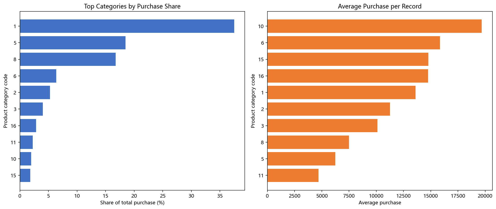
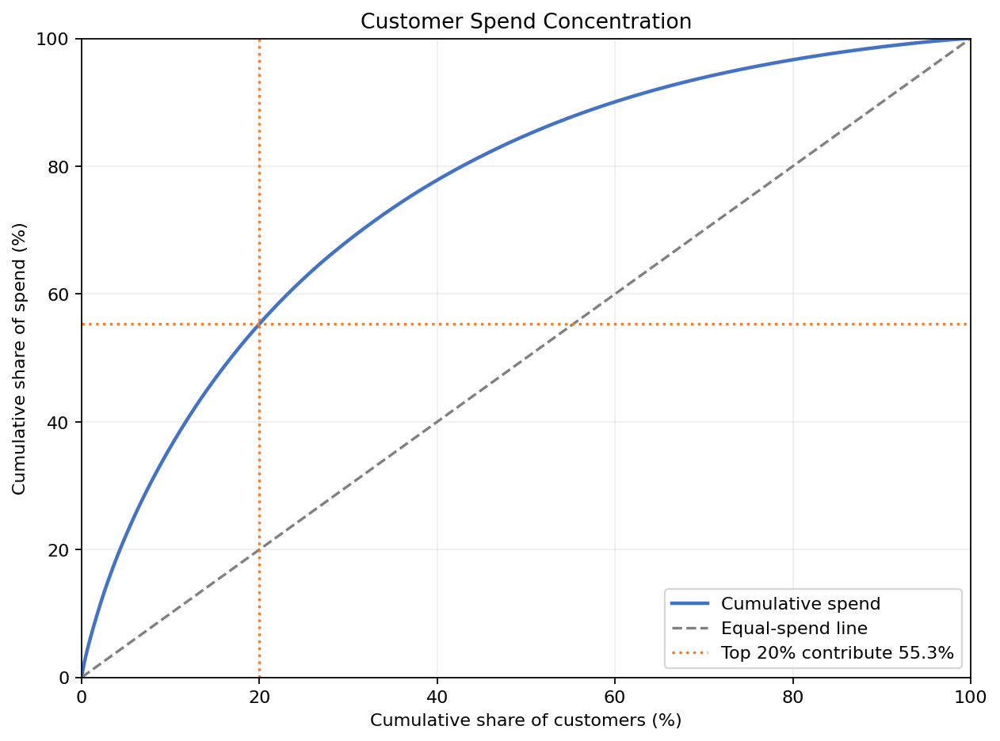
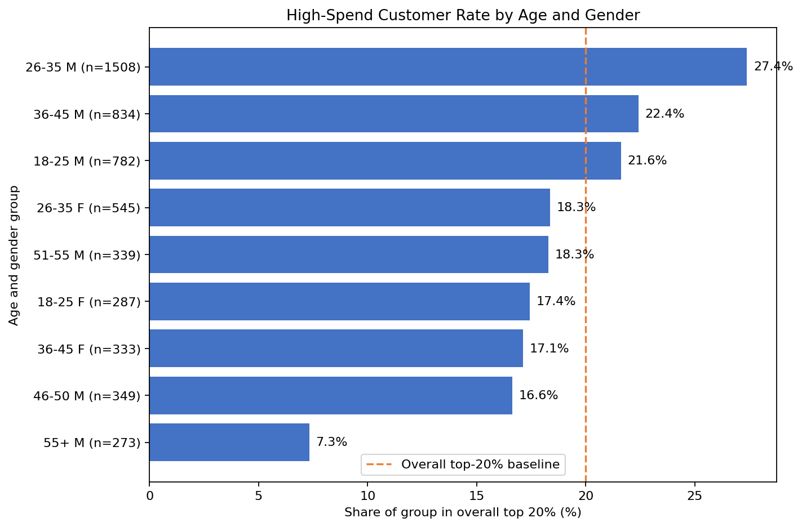

# Black Friday 零售用户消费行为分析

基于 Kaggle 公开购买记录，使用 Python 分析消费行为、商品类别贡献与高消费用户特征。项目为个人分析练习，运营建议尚未经过真实实验验证。

## 数据来源

[Kaggle Black Friday Dataset](https://www.kaggle.com/datasets/aneeshamanke/black-friday-dataset)。包含 550,068 条购买记录、5,891 名用户和 3,631 个商品 ID。

下载并解压，将数据放在以下位置，保留文件名中的空格：

```text
data/raw/black-friday-dataset/BlackFriday dataset.csv
```

原始数据不随代码上传，请从来源页面自行下载。

## 核心发现

- 26–35 岁用户贡献约 39.9% 的全体消费额，该年龄段男性贡献约 31.18% 的全体消费额。
- 26–35 岁男性用户累计消费中位数为 682,712，女性为 461,253；男性减女性的中位数差值为 221,459，Bootstrap 95% 区间为 145,382.5–315,427.09。
- 累计消费额最高的约 20% 用户（1,178 人）贡献 55.33% 的总消费额。
- 商品主类别编码 1、5、8 合计贡献约 72.8% 的总消费额。
- B 类城市贡献约 41.5% 的总消费额。

详细发现和建议见 [分析报告](reports/findings.md)。金额按原始数据单位呈现。

## 图表展示







## 如何运行

使用 Python 3.12，在项目根目录打开终端并安装依赖：

```powershell
python -m pip install -r requirements.txt
```

确认数据放在上述路径后，运行数据审计：

```powershell
python .\01_data_audit.py
```

其他脚本也从项目根目录运行，例如：

```powershell
python .\14_gender_bootstrap.py
```

电脑装有多个 Python 时，可用实际可用的 Python 3.12 可执行文件路径替换 `python`。

## 脚本说明

| 脚本编号 | 内容 |
| --- | --- |
| 01–02 | 数据审计、类别检查 |
| 03–05 | 年龄、性别和用户级消费 |
| 06–07 | 商品类别分析与可视化 |
| 08–09 | 城市类别和用户级消费 |
| 10–11 | 用户消费集中度与帕累托图 |
| 12–13 | 高消费用户画像与可视化 |
| 14 | 男女用户累计消费中位数差异的 Bootstrap 分析 |

`reports/` 保存图表与结论，`requirements.txt` 列出依赖。`notebooks/` 预留用于后续笔记，目前分析由 Python 脚本完成。

## 分析限制

- 无订单编号，购买记录数不能直接解释为订单数或购物频次，也不能确认真实同单购物篮。
- 无日期字段，无法分析时间趋势或计算完整 RFM 指标。
- 商品类别经过脱敏，不能推断具体商品类型；类别 2、3 的缺失含义仍需确认。
- 群体差异不代表因果关系，Bootstrap 区间依赖抽样假设。
- 运营建议为待验证假设，不代表已实现的销售提升。
